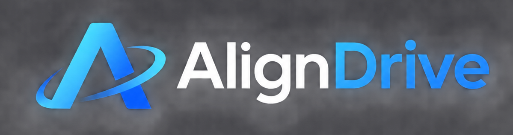

<div align="center">



### AlignDrive: Aligned Lateral-Longitudinal Planning<br>for End-to-End Autonomous Driving

**NeurIPS 2026**

Yanhao Wu<sup>1,2,*</sup>, Haoyang Zhang<sup>2,‡</sup>, Fei He<sup>2</sup>, Rui Wu<sup>2</sup>,<br>
Yanhu Shan<sup>2</sup>, Congpei Qiu<sup>1</sup>, Liang Gao<sup>1</sup>, Wei Ke<sup>1</sup>, Tong Zhang<sup>3,†</sup>

<sup>1</sup> School of Software Engineering, XJTU &nbsp;
<sup>2</sup> Horizon Robotics<br>
<sup>3</sup> University of Chinese Academy of Sciences

<sup>*</sup> Work done during internship at Horizon Robotics.<br>
<sup>†</sup> Corresponding author. &nbsp; <sup>‡</sup> Project leader.

[](https://yanhaowu.github.io/AlignDrive/)&nbsp;
[](https://arxiv.org/pdf/2601.01762)

<a href="#getting-started"><strong>Getting Started</strong></a> &nbsp;|&nbsp;
<a href="#training"><strong>Training</strong></a> &nbsp;|&nbsp;
<a href="#evaluation"><strong>Evaluation</strong></a> &nbsp;|&nbsp;
<a href="#visualization"><strong>Visualization</strong></a> &nbsp;|&nbsp;
<a href="#contact"><strong>Contact</strong></a>

</div>

---

<a id="overview"></a>

## 🌟 What is AlignDrive?

We develop an end-to-end driving framework, **AlignDrive**, that **tightly couples lateral and longitudinal planning** and enables effective **planning-oriented data augmentation**. AlignDrive:

- Demonstrates comprehensive capability in handling diverse driving scenarios.
- Exhibits superior longitudinal planning in challenging, safety-critical situations.
- Demonstrates superior lateral planning and obstacle avoidance performance.
- Outperforms the baseline that performs independent lateral and longitudinal planning.

<a id="results"></a>

## 📊 Reference Results

**Table 1: Closed-loop results of planning in Bench2Drive.** Bold and underlined numbers indicate the best performance within each expert group.

| Method | Driving Score (↑) | SR (%) (↑) | Driving Efficiency (↑) | Comfort (↑) |
| --- | --- | --- | --- | --- |
| **Expert: PDM-Lite ** | | | | |
| SpaceDrive | 78.02 | 55.11 | - | - |
| SimLingo  | **<ins>86.02</ins>** | **<ins>67.27</ins>** | **<ins>259.23</ins>** | **<ins>33.67</ins>** |
| **Expert: Think2Drive ** | | | | |
| VAD  | 42.35 | 15.00 | 157.94 | 46.01 |
| SparseDrive  | 44.54 | 16.71 | 170.21 | **<ins>48.63</ins>** |
| DriveTransformer  | 63.46 | 35.01 | 100.64 | 20.78 |
| Hydra-NeXt  | 73.86 | 50.00 | 197.76 | 20.68 |
| HiP-AD | 86.77 | 69.09 | 203.12 | 19.36 |
| AlignDrive (Ours) | **<ins>89.07</ins>** | **<ins>73.18</ins>** | **<ins>212.07</ins>** | 16.86 |

Weights for AlignDrive in the table above: [Google Drive](https://drive.google.com/file/d/1Z91nzvlXuyzKPjxyViKjjfYOpq7RbU6t/view?usp=drive_link).

<a id="quick-start"></a>

## Getting started

1. [Installation](doc/INSTALL.md)
2. [Data Preparation](#data-preparation)
3. [Training](doc/TRAINING.md)
4. [Evaluation](doc/EVALUATION.md)
5. [Visualization](doc/VISUALIZATION.md)

### Installation

Follow [INSTALL.md](doc/INSTALL.md): [Training](doc/INSTALL.md#training-installation),
[CARLA](doc/INSTALL.md#carla-installation), and
[Visualization](doc/INSTALL.md#visualization-installation).

Tested on **RTX 4090** and **NVIDIA L20** only.

### Data Preparation

#### 1. Bench2Drive Download

Download the **Base** dataset, Town maps, and official train/validation split
from [Bench2Drive](https://github.com/Thinklab-SJTU/Bench2Drive), following the
[official data preparation guide](https://github.com/Thinklab-SJTU/Bench2DriveZoo/blob/uniad/vad/docs/DATA_PREP.md).
See [dataset layout and paths](tools/data_converter/README.md#dataset-download).

#### 2. Data Preprocessing

Generate perception metadata and planning waypoints together:

```bash
bash scripts/prepare_data.sh /path/to/Bench2Drive
```

See [Data Preprocessing](tools/data_converter/README.md) for output files and options.

#### 3. K-Means Anchors

Prepare detection, map, and multi-granularity planning anchors:

```bash
bash scripts/prepare_anchors.sh
```

Existing bundled anchors are reused; missing files are generated from the training
metadata and waypoints. Use `--overwrite` to regenerate all three. See
[Anchor Generation](tools/kmeans_b2d/README.md) for details.

### Training

Train the three stages in order with the default configurations.

**Stage 1: Perception**

```bash
bash scripts/train.sh perception --checkpoint ckpt/resnet50-19c8e357.pth
```

**Stage 2: Spatial**

```bash
bash scripts/train.sh spatial --checkpoint work_dirs/perception/last.pth
```

**Stage 3: Longitudinal Planning**

```bash
bash scripts/train.sh lon --checkpoint work_dirs/spatial/last.pth
```

The final checkpoint is `work_dirs/aligndrive/last.pth`. See [Training](doc/TRAINING.md).

### Evaluation

**1. Bench2Drive Simulation**

```bash
bash scripts/evaluate.sh --checkpoint work_dirs/aligndrive/last.pth
```

**2. Merge and View Results**

```bash
python3 carla_tools/merge.py output/AlignDrive/AlignDrive_full/result
```

Replace the checkpoint path with your own weights. See [Evaluation](doc/EVALUATION.md)
and [Simulation Process Management](doc/SIMULATION.md) for details.

<a id="visualization"></a>

## 🎬 Visualization

```bash
bash scripts/visualize.sh /path/to/saved_scene
```

See [Visualization](doc/VISUALIZATION.md) for input formats, rendering options, and outputs.

<a id="todo"></a>

## 🧩 To-Do List

- [x] Bench2Drive Version
- [ ] Navsim Version

<a id="contact"></a>

## 📬 Contact

For questions or collaboration, please contact:

📧 **[wuyanhao@stu.xjtu.edu.cn](mailto:wuyanhao@stu.xjtu.edu.cn)**

When reporting a problem, include your GPU model, driver / CUDA / PyTorch versions, launch command, configuration, checkpoint checksum, and relevant logs. Remove credentials and private data paths before sharing.

## Acknowledgement

We thank the authors and communities of OpenMMLab, SparseDrive, CARLA, and Bench2Drive for their code and tools.

## Citation

If you find AlignDrive useful, please consider starring this repository and citing our work:

```bibtex
@article{wu2026aligndrive,
  title={AlignDrive: Aligned Lateral-Longitudinal Planning for End-to-End Autonomous Driving},
  author={Wu, Yanhao and Zhang, Haoyang and He, Fei and Wu, Rui and Shan, Yanhu and Qiu, Congpei and Gao, Liang and Ke, Wei and Zhang, Tong},
  journal={arXiv preprint arXiv:2601.01762},
  year={2026}
}
```

## License

See the root [LICENSE](LICENSE). Third-party code retains its own notices and licenses, including
[leaderboard/LICENSE](leaderboard/LICENSE) and [scenario_runner/LICENSE](scenario_runner/LICENSE).
The root MIT license does not replace third-party terms or authorize redistribution
of datasets, anchors, simulator assets, or checkpoints. Review the corresponding
notices before redistributing those materials.
